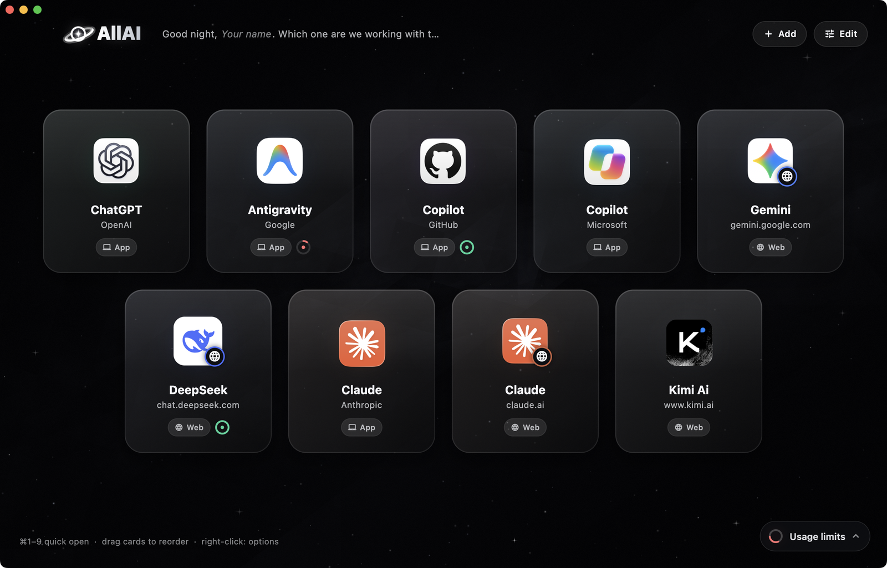

<p align="center">
  
</p>

<p align="center">
  <b>ChatGPT, Claude, Gemini, Copilot, DeepSeek, Antigravity and more — in a single window, with your usage limits at a glance.</b>
</p>

<p align="center">
  <a href="../../releases/latest"></a>
  
  
  
</p>

<p align="center">
  
</p>

## Why

You use several AI assistants. Each lives in its own app or browser tab, and each has its own limits. AllAI puts them side by side: one window, one click to switch, and one panel that shows what is left in each plan.

## Features

- **One window for everything.** Every assistant is a card. On macOS, installed desktop apps are embedded right inside the window; the web version is the fallback. On Windows, cards open as embedded web views.
- **Usage limits at a glance.** Remaining quota per model and plan, reset times, and a summary of what is running low. It refreshes in the background only when the data is stale, and stops while the window is hidden.
- **Add your own.** Add any website, or any installed app, as a card. Drag to reorder, switch between app and web, add a second account.
- **Your language.** English by default. Press **Edit**, then pick English, Türkçe, Deutsch, العربية, Español, Français, Русский or 中文.
- **Your name.** Press **Edit** and tap the name in the greeting to change it.
- **Leaves nothing behind.** **Edit → Reset** deletes every setting, session, cache and profile AllAI created on your computer.

## Download

Get the latest build from the [Releases](../../releases) page:

| Platform | File |
| --- | --- |
| macOS | `AllAI-macOS.dmg` — drag AllAI to Applications |
| Windows | `AllAI-Setup.exe` |

The builds are not code-signed. On macOS, right-click the app and choose **Open** the first time. Embedding other desktop apps in the window needs the Accessibility permission (System Settings → Privacy & Security → Accessibility).

## Build from source

```sh
flutter pub get
flutter run -d macos          # or: -d windows
flutter build macos --release && tool/make_dmg.sh
```

Pushing a tag such as `v1.0.0` builds both installers on GitHub Actions and attaches them to a release (`.github/workflows/release.yml`).

## Windows notes

- **Web mode only.** Every card opens as an embedded web view (Microsoft Edge WebView2). Embedding installed desktop apps in the window, the macOS menu and the macOS-only usage sources (Claude Code keychain, Claude desktop app and Chrome cookies, GitHub CLI, Antigravity) are not available and show "macOS only". Apps you add with **Add → Apps** open in their own window.
- **WebView2 Runtime** is required. It ships with current Windows 10/11; if it is missing, the cards show a message with the download link ([microsoft.com/edge/webview2](https://developer.microsoft.com/microsoft-edge/webview2/)). Sessions and cache live under `%APPDATA%\AllAI`, which **Edit → Reset** and the uninstaller remove.
- **SmartScreen.** The installer is not code-signed, so Windows may show "Windows protected your PC": choose **More info → Run anyway**.
- The Windows build is produced on GitHub Actions and has not been tested on a real Windows machine by the maintainer yet; please report problems.
- Building from source needs Visual Studio with the "Desktop development with C++" workload and `nuget` on the PATH (the WebView2 plugin downloads its SDK through it).

## Privacy

AllAI has no server of its own and no analytics. It connects to the services you open and, for usage limits, to those services' own endpoints using sessions you are already signed in with. When you add a custom site, its icon is fetched from the site itself or from Google's favicon service.

## License

[MIT](LICENSE) — free to use, modify and share. Contributions and bug reports are welcome: open an issue or a pull request.

ChatGPT, Claude, Gemini, Copilot, DeepSeek, Antigravity, Kimi and other names and logos shown in the app belong to their respective owners. AllAI is an independent project and is not affiliated with or endorsed by them.
